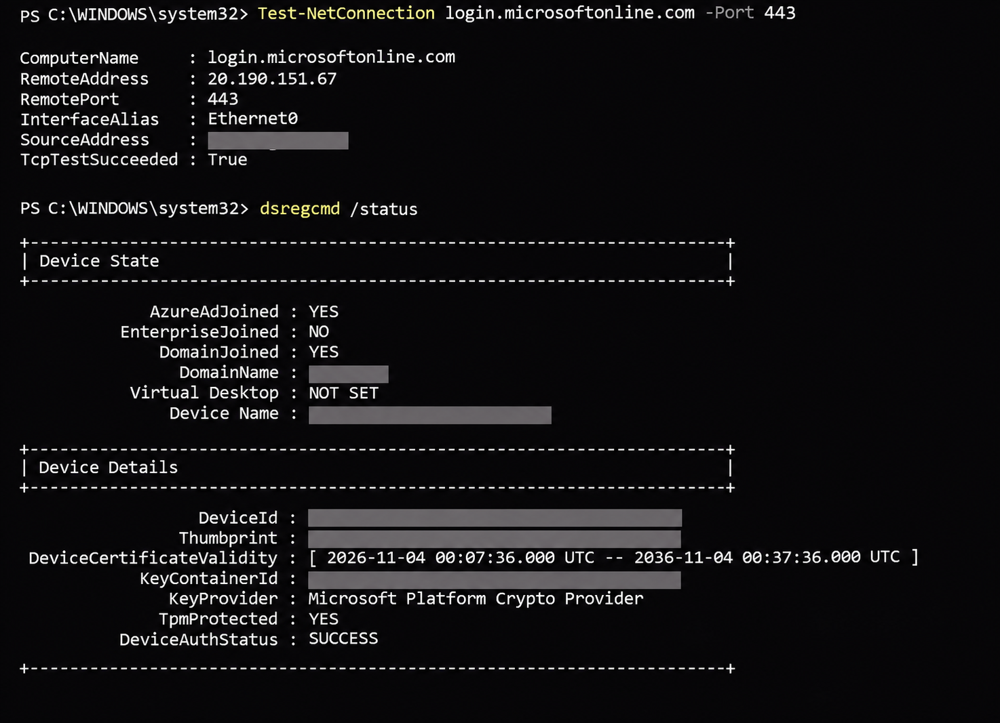
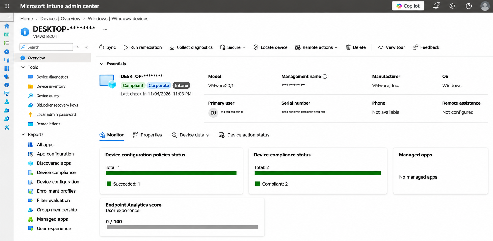
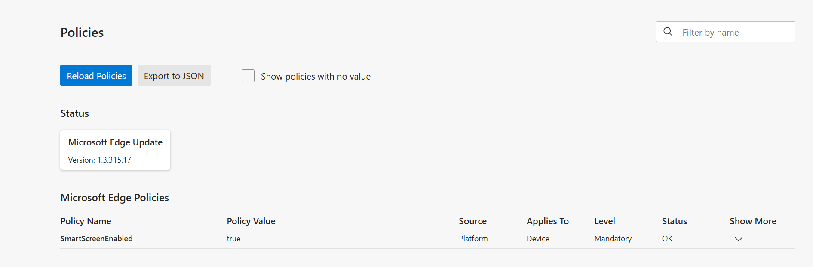
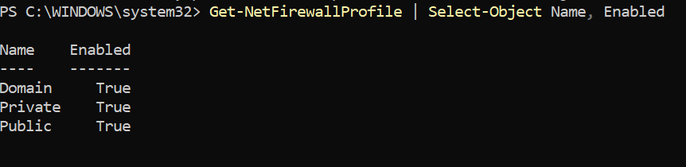
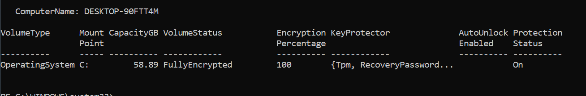
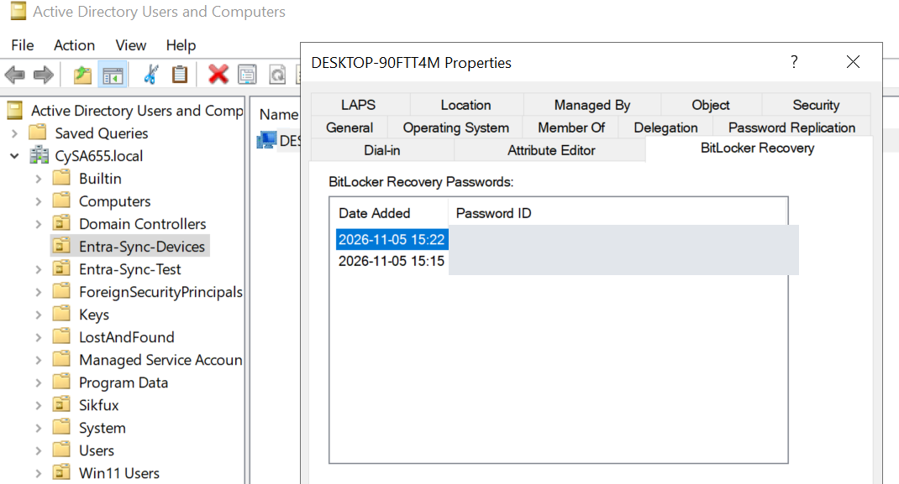
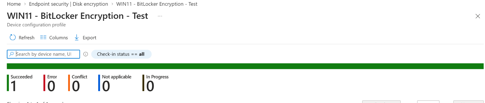

# Hybrid Active Directory, Microsoft Entra ID & Intune Deployment

## Project Overview

I wanted to see how a Windows PC could stay connected to a local Active Directory domain while being managed through Microsoft Intune. I set up Windows Server 2022 and a Windows 11 Enterprise VM in VMware Workstation, then connected them to Microsoft Entra ID and Intune.

I synced identities from Active Directory, set up automatic Intune enrollment, and tested security settings for Edge SmartScreen, Windows Firewall, and BitLocker. I used PowerShell and the Intune admin center to check what was actually working on the VM.

## Technologies Used

- Windows Server 2022, Active Directory Domain Services (AD DS), DNS, and Group Policy
- Microsoft Entra ID and Entra Connect Sync
- Microsoft Intune for device enrollment, configuration, and compliance
- Windows 11 Enterprise and VMware Workstation Pro
- Microsoft Edge SmartScreen and Windows Firewall
- BitLocker, virtual TPM 2.0, PowerShell, and `manage-bde`

## What I Did

1. Set up Active Directory and DNS on Windows Server 2022.
2. Used Entra Connect Sync to sync identities from my local domain to Microsoft Entra ID.
3. Set up hybrid join so the Windows 11 VM could be joined to both Active Directory and Entra ID.
4. Used Group Policy to enroll the VM in Intune automatically.
5. Created and assigned Intune policies for device configuration and compliance.
6. Enabled Edge SmartScreen through Intune and verified that the VM met the Windows Firewall requirement.
7. Set up a BitLocker policy in Intune. I added TPM and recovery-password protectors, backed up the recovery information to Active Directory, and encrypted the Windows drive.
8. Checked BitLocker on the VM and verified that Intune also reported the device as encrypted.

## How I Checked It

| What I checked | How I checked it | What I found |
|---|---|---|
| Hybrid join | `dsregcmd /status` | The VM was joined to both Active Directory and Entra ID. |
| Intune enrollment | Intune device overview | Intune showed the VM as corporate-owned, managed, and compliant. |
| Edge SmartScreen | `edge://policy` | `SmartScreenEnabled` was `true` and marked mandatory. |
| Windows Firewall | PowerShell and Intune compliance | The Domain, Private, and Public profiles were enabled, and the device passed the compliance check. |
| BitLocker encryption | `manage-bde -status C:` | Used-space-only encryption reached 100% with XTS-AES 256, and protection was on. |
| BitLocker protectors | `Get-BitLockerVolume` | The drive had a TPM protector and a recovery-password protector. |
| Recovery password backup | BitLocker Recovery tab in Active Directory Users and Computers | I found the recovery record for the active protector. |
| Intune encryption report | Intune device details | Intune showed `Encrypted: Yes`. |

## Hybrid Join Verification

I ran `dsregcmd /status` on the Windows 11 VM. `DomainJoined` and `AzureAdJoined` both showed `YES`, and `DeviceAuthStatus` showed `SUCCESS`. That confirmed the VM was hybrid joined and could authenticate to Entra ID.




## Intune Enrollment and Compliance Verification

I enrolled my Windows 11 Enterprise VM in Microsoft Intune and checked its status in the Intune admin center. It showed up as corporate-owned and compliant.

The screenshot shows what Intune reported when I first checked. When I checked again later, Intune showed that **two configuration policies had applied successfully** and the VM had **passed two compliance policies**.



## Microsoft Edge SmartScreen Policy Verification

I used Intune to turn on Microsoft Defender SmartScreen in Edge. To check that the policy reached my Windows 11 VM, I opened Edge on the VM and went to `edge://policy`.

- **Policy:** `SmartScreenEnabled`
- **Value:** `true`
- **Source:** Platform
- **Applies to:** Device
- **Level:** Mandatory
- **Status:** OK

Edge showed that SmartScreen was enabled and that the setting was required for everyone using the VM.



## Windows Firewall Compliance Verification

I set up an Intune compliance policy that checks whether Windows Firewall is on. On my Windows 11 VM, I used PowerShell to check that all three firewall profiles were enabled: **Domain**, **Private**, and **Public**. Then I checked Intune and saw that the VM passed the firewall requirement.



## BitLocker Encryption and Recovery Key Management

### Setting up the policy

In Intune, I went to **Endpoint security → Disk encryption** and created a policy called `WIN11 - BitLocker Encryption - Test`. I assigned it to my `Intune-Test-Devices` group.

I set the policy to require BitLocker on the Windows drive using **XTS-AES 256-bit** and **used-space-only encryption**. I also configured TPM protection at startup, required a 48-digit recovery password, and set the policy to require a backup to my local Active Directory (AD DS) before encryption could start. I configured recovery password rotation for Entra-joined and hybrid-joined devices.

### Troubleshooting

Intune showed that the policy had applied, but when I checked the VM, the drive was still fully decrypted. Protection was off, and the drive had no key protectors.

- I checked the drive with `Get-BitLockerVolume` and `manage-bde -status C:`.
- I looked through the BitLocker and device management event logs for errors.
- I checked `HKLM:\SOFTWARE\Microsoft\PolicyManager\current\device\BitLocker` for the Intune settings and ran `gpresult` to look for a Group Policy conflict.
- I verified that the TPM was ready, UEFI Secure Boot was on, and the VM met the automatic encryption requirements. I also checked hybrid join, the connection to Active Directory, and the recovery settings.

I couldn’t confirm why encryption didn’t start automatically. I added the TPM and recovery-password protectors myself, backed up the recovery password to AD DS, and verified the backup in **Active Directory Users and Computers** before starting encryption.

I used these commands to start encryption with the existing protectors and check the result.

```powershell
manage-bde -on C: -em xts_aes256 -usedspaceonly
manage-bde -status C:
```

### How I verified encryption

| What I checked | What I found |
|---|---|
| Windows drive | `C:` |
| Conversion status | Used Space Only Encrypted |
| Encryption progress | 100% |
| Encryption method | XTS-AES 256 |
| Protection status | On |
| Active protectors | TPM and recovery password |



### Recovery-password backup and protector replacement

I opened my Windows 11 computer’s properties in **Active Directory Users and Computers** and used the **BitLocker Recovery** tab to check that the recovery password was backed up to AD DS.

The first recovery password was exposed while I was troubleshooting, so I created a new recovery-password protector and backed it up. Once I confirmed the new protector was active and its backup was in Active Directory, I removed the old protector from the VM and deleted its old backup record.

**Keep recovery passwords private.** For public screenshots, cover the recovery password and show only the redacted record or its password ID.


### Intune encryption reporting

Immediately after local encryption completed, Intune still displayed `Encrypted: No`. After device synchronization and a subsequent check-in, Intune reported **`Encrypted: Yes`** while the device remained compliant. This demonstrated the distinction between **policy application**, **actual disk encryption**, and **cloud reporting**.



## Project Outcome

I connected my local Active Directory to Microsoft Entra ID, enrolled my Windows 11 VM in Intune, and set up security and compliance policies for it. I encrypted the Windows drive with BitLocker and verified that the recovery password was backed up to Active Directory. I checked the encryption status on the VM and confirmed that Intune showed **Encrypted: Yes**.

**Skills I practiced:** Active Directory, Microsoft Entra ID, Entra Connect Sync, Intune, Group Policy, Windows Server, Windows 11, PowerShell, endpoint security, TPM-based BitLocker protection, recovery-key management, and troubleshooting.

**BitLocker verification completed on November 5, 2026.**

## Security and Documentation Notes

- Keep recovery passwords, credentials, and tokens out of public repositories.
- Cover tenant, user, and device details in screenshots before uploading them.
- I verified the recovery password backup in Active Directory (AD DS). Recovery-key backup to Microsoft Entra ID remains unverified.
- The screenshot links point to files in the repository’s `screenshots/` folder. Use the filenames shown in the links when uploading redacted images.
