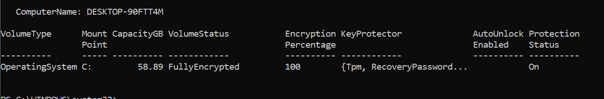
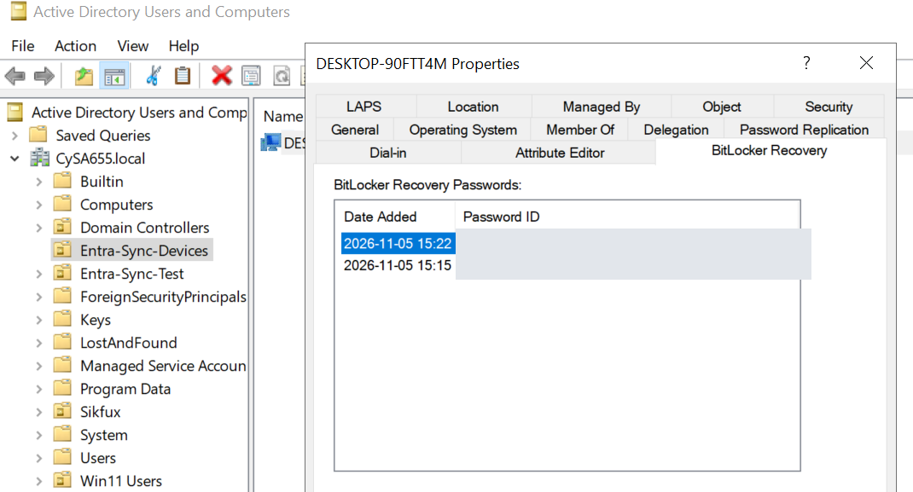
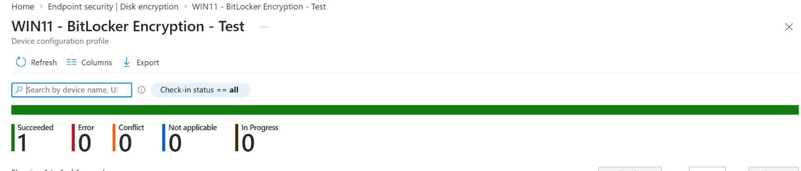

# Hybrid Active Directory, Microsoft Entra ID & Intune Deployment

## Project Overview

Designed and configured a hybrid identity and endpoint management environment integrating on-premises Active Directory Domain Services (AD DS), Microsoft Entra ID, and Microsoft Intune. Implemented identity synchronization, hybrid device join, automatic MDM enrollment, endpoint security and compliance policies, and BitLocker encryption with recovery-password escrow to AD DS.

The environment uses Windows Server 2022 and a Windows 11 Enterprise virtual machine in VMware Workstation. The project demonstrates hands-on experience with enterprise identity, endpoint administration, PowerShell troubleshooting, and security controls.

## Technologies Used

- Windows Server 2022; Active Directory Domain Services (AD DS); DNS; Group Policy
- Microsoft Entra Connect Sync and Microsoft Entra ID
- Microsoft Intune (device enrollment, configuration, compliance, endpoint security)
- Windows 11 Enterprise; VMware Workstation Pro
- Microsoft Edge SmartScreen; Windows Firewall
- BitLocker Drive Encryption; virtual TPM 2.0; PowerShell; `manage-bde`

## Implementation

1. Configured Active Directory and DNS services on Windows Server 2022.
2. Implemented on-premises AD identity synchronization with Microsoft Entra ID using Entra Connect Sync.
3. Configured hybrid Microsoft Entra join for a Windows 11 Enterprise endpoint.
4. Enabled automatic Microsoft Intune enrollment through Group Policy.
5. Created and assigned Intune device configuration and compliance policies.
6. Deployed and verified Microsoft Edge SmartScreen settings and Windows Firewall compliance.
7. Configured an Intune BitLocker disk encryption policy; created TPM and recovery-password protectors; backed up recovery information to AD DS; and encrypted the OS drive.
8. Verified local BitLocker protection and subsequent Intune encryption reporting.

## Validation Summary

| Control | Verification | Result |
|---|---|---|
| Hybrid Microsoft Entra join | `dsregcmd /status` | Verified |
| Intune enrollment | Intune device overview | Corporate-managed, compliant |
| Edge SmartScreen | `edge://policy` | `SmartScreenEnabled = true`, mandatory |
| Windows Firewall | PowerShell and Intune compliance | Domain, Private, Public enabled; compliant |
| BitLocker | `manage-bde -status C:` | 100% used-space-only encrypted, XTS-AES 256, Protection On |
| BitLocker protectors | `Get-BitLockerVolume` | TPM and RecoveryPassword |
| Recovery escrow | ADUC BitLocker Recovery tab | Active recovery-password record verified in AD DS |
| Encryption reporting | Intune device details | `Encrypted: Yes` |

## Hybrid Join Verification

Verified successful hybrid Microsoft Entra join and cloud device authentication using `dsregcmd /status`.


## Intune Enrollment and Compliance Verification

Enrolled the Windows 11 Enterprise endpoint in Microsoft Intune and verified corporate ownership and compliance. The original enrollment screenshot documents the earlier configuration state; subsequent checks confirmed **two configuration policies succeeded** and **two compliance policies were compliant**.


## Microsoft Edge SmartScreen Policy Verification

Deployed Microsoft Edge SmartScreen configuration through Intune and confirmed enforcement using `edge://policy`:

- Policy: `SmartScreenEnabled`
- Value: `true`
- Source: Platform; applies to Device
- Level: Mandatory; status: OK


## Windows Firewall Compliance Verification

Configured an Intune compliance policy requiring Windows Firewall. Verified the **Domain**, **Private**, and **Public** firewall profiles were enabled, and confirmed Intune reported the device compliant.


## BitLocker Encryption and Recovery Key Management

### Policy configuration

Created the Intune Endpoint security → Disk encryption policy `WIN11 - BitLocker Encryption - Test`, assigned to the `Intune-Test-Devices` group. Configured:

- Required device encryption; **XTS-AES 256-bit** for OS drives; **used-space-only** encryption
- TPM-based startup protection and a required 48-digit recovery password
- Recovery information backup to on-premises **AD DS**, required before encryption
- Recovery password rotation settings for Microsoft Entra-joined and hybrid-joined devices

The VM's TPM readiness, UEFI Secure Boot, automatic encryption prerequisites, hybrid join, and AD DS connectivity were verified before encryption.

### Deployment and troubleshooting

Intune successfully delivered the BitLocker policy, but **policy success did not initially result in drive encryption**. Local checks showed `FullyDecrypted`, `Protection Off`, and no protectors. Troubleshooting included:

- Checking BitLocker state with `Get-BitLockerVolume` and `manage-bde -status C:`
- Reviewing BitLocker and DeviceManagement-Enterprise-Diagnostics-Provider event logs
- Verifying MDM policy values under `HKLM:\SOFTWARE\Microsoft\PolicyManager\current\device\BitLocker`
- Inspecting applied Group Policy with `gpresult` for potential conflicts
- Confirming TPM readiness, Secure Boot, domain secure-channel connectivity, and recovery policy settings

No definitive cause for the lack of automatic encryption was established. To complete the deployment, TPM and recovery-password protectors were created manually. The recovery password was backed up to AD DS and verified in Active Directory Users and Computers **before encryption was enabled**.

Encryption was initiated using the existing protectors:

```powershell
manage-bde -on C: -em xts_aes256 -usedspaceonly
manage-bde -status C:
```

### Encryption verification

| Setting | Verified result |
|---|---|
| Operating system volume | `C:` |
| Conversion status | Used Space Only Encrypted |
| Percentage encrypted | 100% |
| Encryption method | XTS-AES 256 |
| Protection status | On |
| Active protectors | TPM and RecoveryPassword |



### Recovery-password backup and protector replacement

Verified recovery-password escrow under the Windows 11 computer object in AD DS using the BitLocker Recovery tab. After the initial recovery password was exposed during troubleshooting, created a replacement recovery-password protector, backed it up to AD DS, verified the new record, and removed the original protector. Deleted the obsolete AD DS recovery object only after confirming the replacement was active and stored.

**Do not publish recovery passwords.** Any ADUC screenshots should show only redacted recovery records or password IDs.



### Intune encryption reporting

Immediately after local encryption completed, Intune still displayed `Encrypted: No`. After device synchronization and a subsequent check-in, Intune reported **`Encrypted: Yes`** while the device remained compliant. This demonstrated the distinction between **policy application**, **actual disk encryption**, and **cloud reporting**.



## Project Outcome

Completed hybrid identity synchronization, device enrollment, endpoint security and compliance configuration, and BitLocker encryption with AD DS recovery-password escrow. Validated encryption both locally and through Intune device reporting.

**Skills demonstrated:** Active Directory, Microsoft Entra ID, Entra Connect Sync, Microsoft Intune, Group Policy, Windows Server, Windows 11, PowerShell, endpoint security, TPM-based BitLocker protection, recovery-key management, and systematic troubleshooting.

**BitLocker implementation verified:** November 5, 2026.

## Security and Documentation Notes

- Never commit BitLocker recovery passwords, credentials, tokens, or unredacted recovery screenshots to a public repository.
- Review screenshots for sensitive tenant, user, and device identifiers before publishing.
- AD DS recovery-password escrow was verified; **Microsoft Entra ID recovery-key escrow was not independently verified** in this implementation.
- Screenshot links above are relative paths. Add appropriately named, sanitized images to the repository's `screenshots/` directory.
