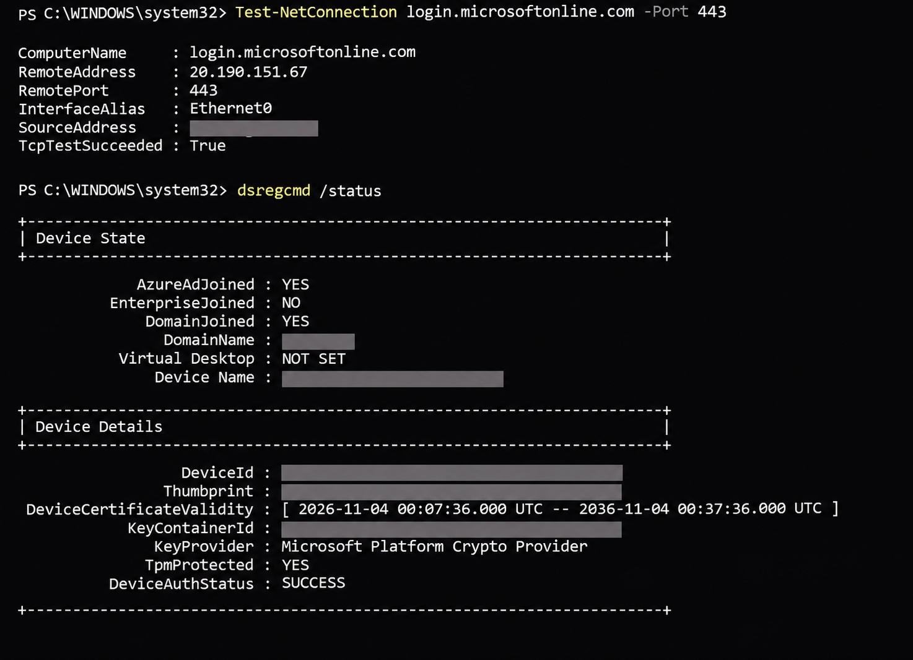
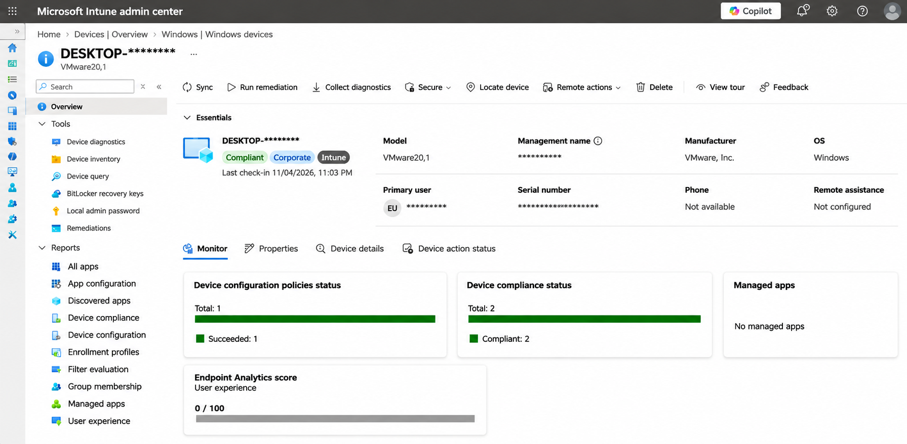
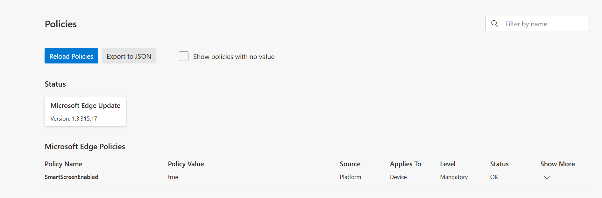
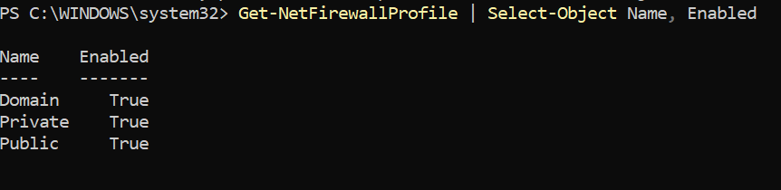

# Hybrid Active Directory, Microsoft Entra ID & Intune Deployment

## Project Overview
Designed and configured a hybrid identity and endpoint management environment integrating on-premises Active Directory with Microsoft Entra ID and Microsoft Intune.

The project demonstrates practical experience with identity synchronization, Windows device management, Group Policy, and endpoint security.

## Technologies Used
- Windows Server 2022
- Active Directory Domain Services (AD DS)
- DNS and Group Policy
- Microsoft Entra Connect Sync
- Microsoft Entra ID
- Microsoft Intune
- Windows 11 Enterprise
- VMware Workstation

## Implementation
- Configured Active Directory and DNS services.
- Implemented identity synchronization between on-premises AD and Microsoft Entra ID.
- Configured hybrid Microsoft Entra join for a Windows 11 Enterprise device.
- Enabled automatic Intune enrollment using Group Policy.
- Created and assigned an Intune device configuration profile.
- Deployed Microsoft Defender SmartScreen settings.
- Configured and verified a Windows Firewall compliance policy.

## Validation
- Verified hybrid device join using `dsregcmd /status`.
- Confirmed Microsoft Defender SmartScreen enforcement through `edge://policy`.
- Verified Windows Firewall status using PowerShell.
- Confirmed successful device enrollment and compliance reporting in Microsoft Intune.

## Project Status
**Completed:** Hybrid identity synchronization, device enrollment, security configuration, and compliance verification.

**Planned:** BitLocker encryption management, recovery-key escrow, and additional endpoint security configurations.

## Purpose
Demonstrate hands-on technical experience with hybrid Microsoft infrastructure, endpoint administration, and security management relevant to enterprise IT support and systems administration.

## Hybrid Join Verification

The following screenshot confirms successful hybrid Microsoft Entra join, TPM protection, and cloud device authentication.

## Intune Enrollment and Compliance Verification

The Windows 11 Enterprise endpoint was successfully enrolled in Microsoft Intune and classified as a corporate-managed device.

The Intune admin center confirms:
- Device compliance: **Compliant**
- Device ownership: **Corporate**
- Management platform: **Microsoft Intune**
- Configuration policies: **1 succeeded**
- Compliance policies: **2 compliant**

## Microsoft Edge SmartScreen Policy Verification

Deployed a Microsoft Edge SmartScreen security configuration
through Microsoft Intune and verified enforcement on the
Windows 11 Enterprise endpoint.

**Verification results:**
- Policy: SmartScreenEnabled
- Value: true
- Source: Platform
- Applies to: Device
- Level: Mandatory
- Status: OK

## Windows Firewall Compliance Verification

Configured a Microsoft Intune compliance policy requiring
Windows Firewall to be enabled.

Verified the endpoint firewall configuration using PowerShell.

**Results:**
- Domain: Enabled
- Private: Enabled
- Public: Enabled
- Intune compliance policy: Compliant

